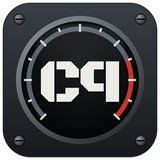
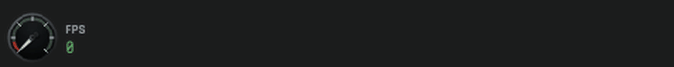
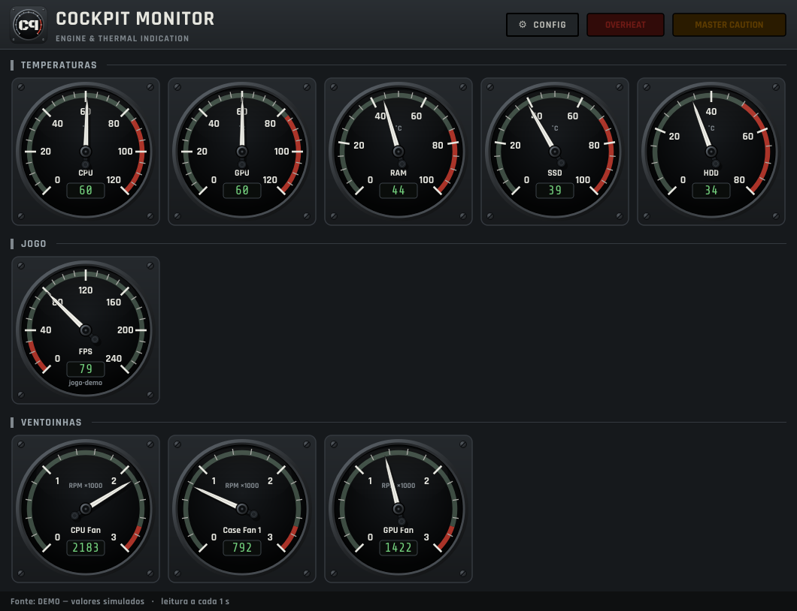
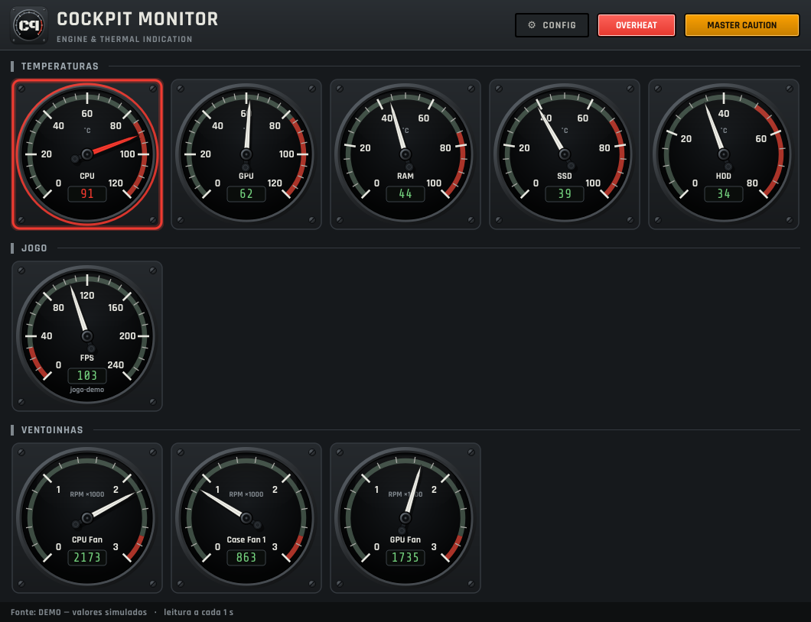
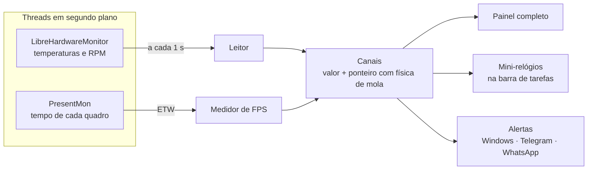

<p align="center">
  
</p>

<h1 align="center">Cockpit Monitor</h1>

<p align="center">
  Monitor de hardware para Windows com mostradores analógicos no estilo <b>painel de avião</b>:
  temperaturas, ventoinhas e FPS dos jogos, direto na barra de tarefas.
</p>

<p align="center">
  
  
  
  
  <a href="https://livepix.gg/n0rdico"></a>
</p>

<p align="center">
  
  <br><sub>"Partida do motor": ao ligar o PC os relógios acendem um por vez na barra de tarefas</sub>
</p>

---

## Sobre o projeto

Eu queria acompanhar a temperatura do PC enquanto jogo **sem abrir um programa pesado** e sem
ocupar a tela. O Cockpit Monitor fica discreto na barra de tarefas, ao lado do relógio do
Windows, e abre um painel completo com um clique. O visual imita instrumentos de cockpit: o
ponteiro fica branco no normal e **vermelho piscando** quando passa do limite.

## Funcionalidades

- 🌡️ **Temperaturas** de CPU, GPU, RAM, SSD e HDD, além do **RPM das ventoinhas**
- 🎮 **FPS do jogo aberto**, detectado automaticamente, sem injetar nada no jogo (seguro para anti-cheat)
- 📌 **Mini-relógios na barra de tarefas**, em qualquer monitor (ótimo no segundo monitor durante o jogo)
- ✈️ **Animação de "partida do motor"**: cada relógio liga, vai até o vermelho e estabiliza
- 🚨 **Alertas**: ponteiro e halo vermelhos piscando, luzes *OVERHEAT* e *MASTER CAUTION*
- 📱 **Aviso no celular** pelo Telegram ou WhatsApp quando algo esquentar
- 🎨 **Temas e cores** configuráveis (Grafite, Cockpit verde, Verde-oliva, Visão noturna, Âmbar)
- ⚡ **Leve**: cerca de 0,4% de um núcleo de CPU com a temperatura estável
- 🚀 **Inicia com o Windows** já minimizado na barra; versão **portátil** (sem instalar)

## Capturas de tela

<p align="center">
  
  <br><sub>Painel completo: temperaturas, FPS do jogo e ventoinhas</sub>
</p>

<p align="center">
  
  <br><sub>CPU acima do limite: ponteiro vermelho, moldura piscando e luzes de alerta acesas</sub>
</p>

## Tecnologias

| Área | O que foi usado |
|---|---|
| Linguagem | **Python 3.12** |
| Interface | **PySide6 (Qt 6)**: desenho vetorial com `QPainter`, anti-aliasing, animação a 60 fps |
| Sensores | **[LibreHardwareMonitor](https://github.com/LibreHardwareMonitor/LibreHardwareMonitor)** (.NET) acessado do Python via **pythonnet** |
| FPS | **[PresentMon](https://github.com/GameTechDev/PresentMon)** (Intel): lê eventos ETW de apresentação de quadros |
| Windows | **API Win32 via `ctypes`**: posição da barra de tarefas, monitores, *WinEvent hooks*, detecção de tela cheia |
| Discos | **WMI** (`MSFT_PhysicalDisk`) para diferenciar SSD de HDD |
| Inicialização | **Agendador de Tarefas** do Windows (roda como administrador sem o aviso do UAC) |
| Distribuição | **PyInstaller** (versão portátil) e **Inno Setup** (instalador) |

## Como funciona



- A leitura dos sensores roda **em outra thread**, para a interface nunca travar.
- Cada sensor vira um **canal** com o valor real e a posição animada do ponteiro, que usa uma
  mola amortecida e por isso acelera e freia suave, sem passar do ponto.
- O painel e a barra de tarefas são só **visões** dos mesmos canais.

## Desafios e o que aprendi

- **O Windows não entrega a temperatura da CPU para programas comuns.** Ela fica em registradores
  do processador e exige um driver. A solução foi usar a biblioteca .NET do LibreHardwareMonitor
  a partir do Python, com o **pythonnet**.
- **Desempenho.** A primeira versão usava cerca de 24% de um núcleo de CPU. Medindo, descobri que a
  barra era redesenhada inteira, 60 vezes por segundo, por qualquer sensor. Com **cache das partes
  fixas** dos relógios, **redesenho só da área que mudou** e animação apenas quando algo se mexe,
  caiu para cerca de 0,4%.
- **Desenhar "dentro" da barra de tarefas do Windows 11**, que não permite isso oficialmente. Usei
  uma janela transparente posicionada pela API Win32, que volta para cima na hora graças a um
  *WinEvent hook*.
- **Medir FPS sem mexer no jogo.** Em vez de injetar código, como fazem alguns overlays, o programa
  lê os eventos de quadro que o próprio Windows registra (ETW, via PresentMon).
- **Vários monitores com escalas diferentes** (100%, 125%, 150%): conversão entre pixels físicos e
  lógicos por monitor.
- **Abrir rápido junto com o Windows**: sensores carregados em segundo plano, build em pasta em vez
  de executável único, e espera ativa até a barra de tarefas existir.

## Como usar

### Baixar pronto
Vá em **[Releases](../../releases)**, baixe o `.zip`, extraia a pasta `CockpitMonitor` e abra o
`CockpitMonitor.exe`. Ele pede permissão de administrador, necessária para ler a CPU, os discos e o FPS.

### Rodar a partir do código
```bash
python -m pip install -r requirements.txt
python cockpit_monitor.py --demo     # valores simulados, funciona em qualquer PC
```

### Gerar o executável
Dê dois cliques em **`build_exe.bat`**. Ele instala as dependências, baixa o LibreHardwareMonitor e
o PresentMon e gera a pasta `Portatil\CockpitMonitor`. Se o Inno Setup 6 estiver instalado, gera
também o instalador.

| Opção | Efeito |
|---|---|
| `--demo` | valores simulados |
| `--show` | abre o painel completo ao iniciar |
| `--minimized` | abre só os mini-relógios |
| `--interval 2` | segundos entre leituras |

## Estrutura

```
cockpit_monitor.py    aplicativo (interface, sensores, alertas, FPS)
build_exe.bat         gera a versão portátil e o instalador
get_lhm.ps1           baixa o LibreHardwareMonitor (usado pelo build)
get_presentmon.ps1    baixa o PresentMon (usado pelo build)
installer.iss         script do instalador (Inno Setup)
fonts/                fontes do painel (Rajdhani e Share Tech Mono, licença OFL)
docs/                 imagens deste README
```

## 💡 Sugestões e problemas

Tem uma ideia ou encontrou um bug? O próprio app tem esses atalhos em **Configurações → Sobre**.

- [**Sugerir uma melhoria**](../../issues/new?template=ideia.yml)
- [**Relatar um problema**](../../issues/new?template=bug.yml)

## ☕ Apoie o projeto

Se o Cockpit Monitor te ajudou, considere apoiar o desenvolvimento:

<p>
  <a href="https://livepix.gg/n0rdico"><b>➜ Doar via Pix (LivePix)</b></a>
  &nbsp;·&nbsp; ou deixe uma ⭐ no repositório, que também ajuda muito!
</p>

## Créditos e licenças

- Código deste projeto: **[MIT](LICENSE)**
- [LibreHardwareMonitor](https://github.com/LibreHardwareMonitor/LibreHardwareMonitor) (MPL-2.0) e
  [PresentMon](https://github.com/GameTechDev/PresentMon) (MIT): baixados durante o build, não
  incluídos neste repositório
- Fontes [Rajdhani](https://fonts.google.com/specimen/Rajdhani) e
  [Share Tech Mono](https://fonts.google.com/specimen/Share+Tech+Mono): SIL Open Font License 1.1

---

<p align="center">Feito por <b>Saymon Santos</b> · estudante de Análise e Desenvolvimento de Sistemas</p>
